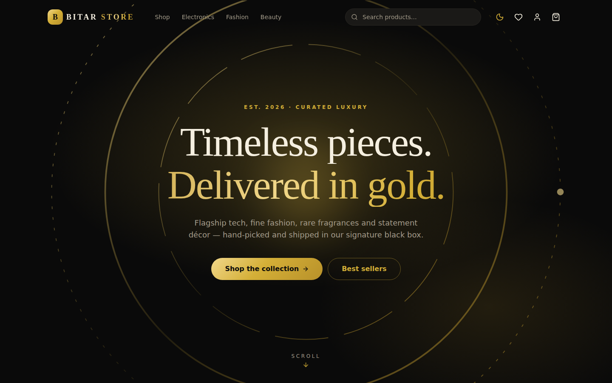
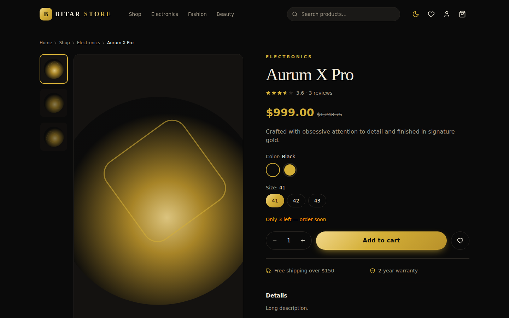
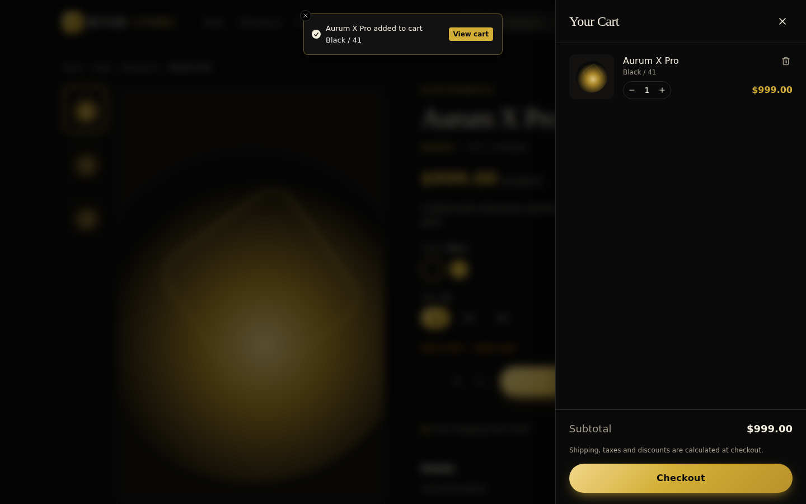
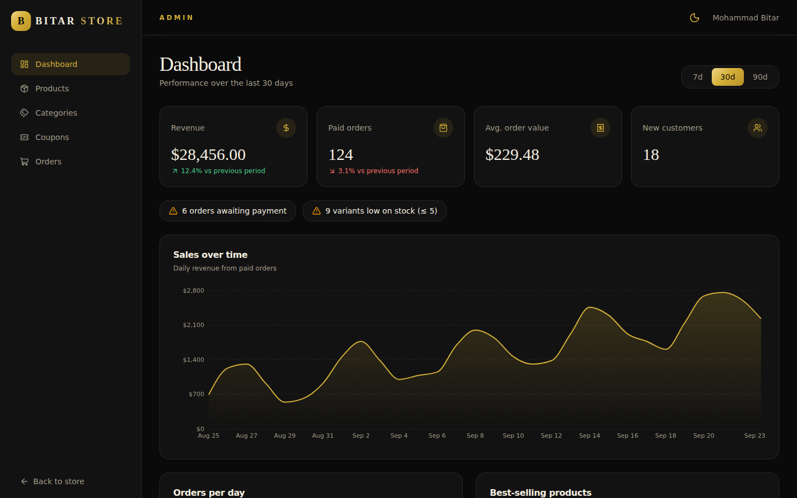
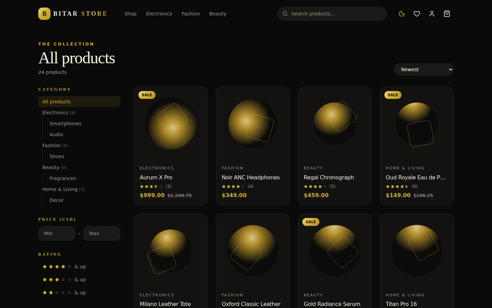
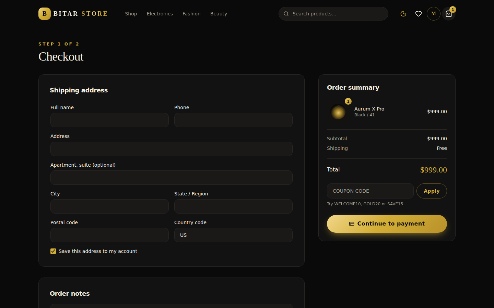
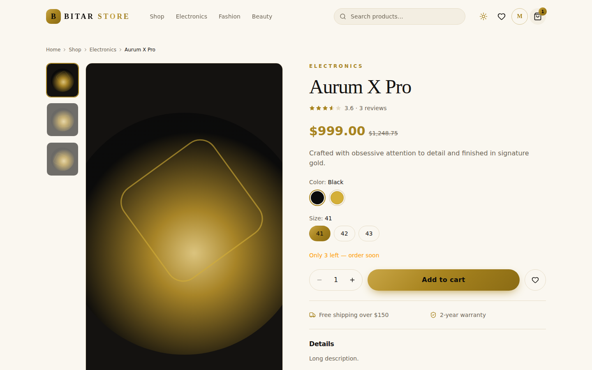
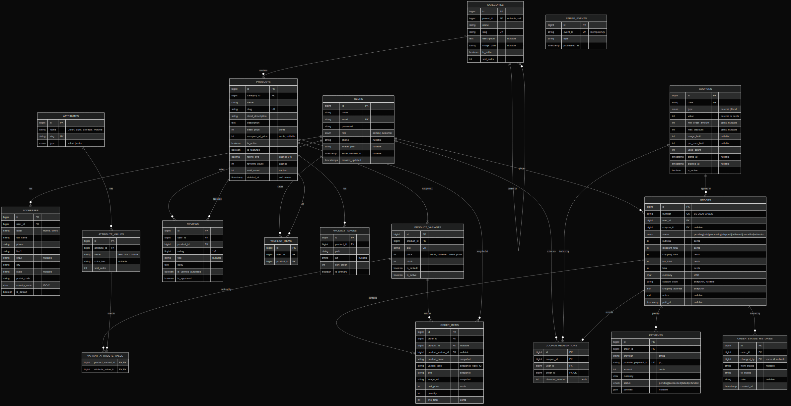

<div align="center">

# BITAR STORE

**A full-stack, animated e-commerce store in black & gold.**
Laravel 13 REST API · React 19 + TypeScript · Stripe · Framer Motion · GSAP



</div>

---

## Features

**Storefront**

- Scroll-driven hero (GSAP ScrollTrigger, pinned), featured products, category showcase
- Catalogue with category / price / rating / stock filters, search, sort and pagination. All state lives in the URL, so every view can be shared.
- Skeleton loaders and staggered, animated grid changes
- Product page with a zoomable gallery, colour swatches and size chips (unavailable combinations are disabled), live stock and reviews with a rating breakdown
- Slide-in cart drawer, a "fly-to-cart" animation, an animated cart counter and toasts
- Wishlist, coupons, Stripe Payment Element checkout (test mode), order history, a status timeline and "pay later" for unpaid orders
- Register / login / logout / profile / change password / password reset by email
- Dark (default) and ivory light themes, fully responsive, and `prefers-reduced-motion` respected everywhere

**Admin**

- Role-based access (admin / customer), enforced by middleware and policies
- Products with a variant builder (generate every combination of options), multi-image upload and a main-image picker
- Categories (nested), coupons (percent/fixed, limits, dates), order management with a strict status state machine and Stripe refunds
- Dashboard: revenue over time, orders per day, best sellers, KPIs with period-over-period change

| Product | Cart | Admin |
|---|---|---|
|  |  |  |
|  |  |  |

> Product photos are downloaded once with `php artisan store:download-images` (free demo imagery from DummyJSON) into `backend/public/images/products` and committed with the project. If a photo is missing, the API draws a black & gold placeholder instead.

## Tech stack

| Layer | Tools |
|---|---|
| API | Laravel 13, PHP 8.3+, MySQL 8, Sanctum (Bearer tokens), Form Requests, API Resources, Policies, Service classes |
| Payments | Stripe PaymentIntents + signed webhooks (test mode), idempotent event handling |
| Tests | Pest (Feature + Unit), in-memory SQLite, a fake payment gateway |
| Frontend | React 19, Vite, TypeScript, Tailwind CSS v4, React Router, TanStack Query, Zustand, React Hook Form + Zod |
| Motion | Framer Motion (UI), GSAP ScrollTrigger (hero only) |

## Architecture

```
bitar-store/
├── backend/                 Laravel REST API (/api/v1)
│   ├── app/Enums            OrderStatus (state machine), UserRole, CouponType…
│   ├── app/Exceptions       BusinessException + ApiExceptionRenderer (one JSON error shape)
│   ├── app/Http             Thin controllers, Form Requests, API Resources, middleware
│   ├── app/Policies         Authorization rules
│   ├── app/Services         Business logic: Checkout, CartPricing, Coupon, Order, StripeWebhook, Dashboard…
│   │   └── Payments         PaymentGateway interface → Stripe / Fake implementations
│   ├── database             Migrations, factories, realistic seeders
│   └── tests                Pest feature & unit tests
├── frontend/                React SPA
│   └── src/{app,components,features,pages,stores,lib,types}
└── docs/                    ERD, screenshots, deployment guide, phase notes
```



### Key decisions

- **Money is stored as integer cents** everywhere, which is the same unit Stripe uses, so there are no floating-point errors.
- **Every product has at least one variant.** Stock and SKU live on `product_variants`, so the cart, checkout and inventory only ever deal with one table.
- **Orders keep snapshots** of the product name, price, SKU, image and address, so later catalogue edits never change past orders.
- **The server never trusts client prices.** `CartPricingService` re-prices every quote and checkout.
- **Checkout is concurrency-safe.** Variant rows are locked with `SELECT … FOR UPDATE` inside a transaction, and coupon usage is incremented with a conditional atomic update.
- **Stripe webhooks are verified and idempotent.** There is a signature check, a `stripe_events` unique key and an amount check, and the network call happens outside DB transactions.
- **Unpaid orders reserve stock for 60 minutes.** A scheduled command (`orders:expire-pending`) releases it afterwards.
- **Every error uses one JSON shape:** `{ "message": "...", "code": "out_of_stock", "errors": { … } }`.

## Getting started

Requirements: PHP 8.3+, Composer, MySQL 8, Node 20+.

```bash
# 1) API
cd backend
cp .env.example .env            # set DB_* (and Stripe test keys, optional)
composer install
php artisan key:generate
php artisan store:download-images   # optional: only if public/images/products is empty
php artisan migrate:fresh --seed
php artisan storage:link
php artisan serve               # http://localhost:8000

# 2) Frontend
cd ../frontend
cp .env.example .env            # VITE_API_URL=http://localhost:8000/api/v1
npm install
npm run dev                     # http://localhost:5173
```

**Demo accounts** (password `Password123`)

| Role | Email |
|---|---|
| Admin | `admin@bitarstore.test` |
| Customer | `customer@bitarstore.test` |

**Coupons:** `WELCOME10`, `GOLD20` (min $200), `SAVE15` (min $75), `EXPIRED5` (expired, for testing).

### Stripe (test mode)

1. Put your test keys (`pk_test_…`, `sk_test_…`) in `backend/.env`.
2. Forward webhooks: `stripe listen --forward-to localhost:8000/api/v1/webhooks/stripe`, then copy the `whsec_…` into `STRIPE_WEBHOOK_SECRET`.
3. Pay with `4242 4242 4242 4242`, any future date and any CVC.

Without Stripe keys, set `PAYMENT_GATEWAY=fake`. Checkout then shows a **Simulate payment** button so the whole flow works offline.

### Tests

```bash
cd backend && php artisan test      # or: ./vendor/bin/pest
cd frontend && npm run typecheck && npm run build
```

## API overview

| Method | Endpoint | Auth |
|---|---|---|
| POST | `/auth/register`, `/auth/login`, `/auth/forgot-password`, `/auth/reset-password` | – (throttled) |
| GET/POST | `/auth/me`, `/auth/logout` | token |
| GET | `/products?search&category&min_price&max_price&rating&in_stock&sort&page` | – |
| GET | `/products/{slug}`, `/products/{slug}/reviews`, `/products/{slug}/related`, `/categories` | – |
| POST | `/cart/quote` | optional |
| POST | `/products/{slug}/reviews` · `/wishlist/{id}` · `/checkout` | token |
| GET/POST | `/orders`, `/orders/{number}`, `/orders/{number}/cancel`, `/orders/{number}/pay` | token |
| POST | `/webhooks/stripe` | Stripe signature |
| * | `/admin/dashboard`, `/admin/products`, `/admin/categories`, `/admin/coupons`, `/admin/orders` | admin |

## Performance

- Route-level code splitting (every page is its own chunk). Admin-only libraries such as Recharts never load for shoppers.
- Vendor chunks (react / data / motion) for long-term caching
- Lazy images with explicit dimensions and fade-in, `fetchpriority="high"` on the hero product image
- TanStack Query caching with `keepPreviousData` so filter changes never flash
- Animations only touch `transform` and `opacity`, between 200 and 400 ms

## Deployment

See [docs/DEPLOYMENT.md](docs/DEPLOYMENT.md) (Nginx + PHP-FPM + MySQL + queue/scheduler + SPA hosting).

---

© 2026 Mohammad Bitar
